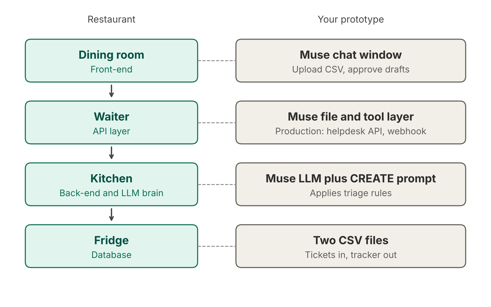

# AI-Assisted Support Ticket Triage

**BUAN 3301: AI in Business, Assignment 4**
Author: Adrian Obaitan

**Video pitch:** [paste link here]

A working prototype of an AI agent that triages customer support tickets. It classifies each ticket, assigns a priority, routes it to the right queue, drafts a reply when it is safe to do so, and then **pauses for human approval** before anything is finalized.

**Use case:** Customer Service, a "Quick Win" (high impact, high feasibility, low risk). **Goal:** Cost Reduction.

---

## System architecture (the Restaurant Analogy)

| Restaurant | Prototype |
|---|---|
| Dining room (front-end) | Muse chat window |
| Waiter (API layer) | Muse file and tool layer (production: helpdesk API, webhook) |
| Kitchen (back-end and LLM) | LLM plus CREATE prompt |
| Fridge (database) | Two CSV files |

Details: [docs/architecture.md](docs/architecture.md)

---

## 1-year financial case

| | Amount |
|---|---|
| Total value | $192,000 |
| Total investment | $35,600 |
| **ROI** | **about 439%** |
| **Payback period** | **about 2.2 months** |

Assumptions and calculation: [docs/tokenomics_and_roi.md](docs/tokenomics_and_roi.md)

---

## Contents

| File | What it contains |
|---|---|
| [docs/business_case.md](docs/business_case.md) | Domain, Quick Win placement on the Hype vs. Value matrix |
| [data/data_dictionary.md](data/data_dictionary.md) | Synthetic dataset, business rules, and edge cases |
| [data/synthetic_support_tickets.csv](data/synthetic_support_tickets.csv) | 41 fabricated tickets with expected answers |
| [prompts/triage_system_prompt.md](prompts/triage_system_prompt.md) | The full CREATE system prompt |
| [docs/agentic_loop.md](docs/agentic_loop.md) | Perception, Reasoning, Action, Review, with screenshots |
| [docs/red_team_report.md](docs/red_team_report.md) | Three adversarial tests, before and after |
| [data/redteam/](data/redteam/) | Red-team test files |
| [docs/governance.md](docs/governance.md) | Human-in-the-loop, liability, and enterprise security controls |
| [docs/tokenomics_and_roi.md](docs/tokenomics_and_roi.md) | Model routing, assumptions, ROI, payback, KPIs |

*All data in this project is synthetic. No real customer information was used.*
