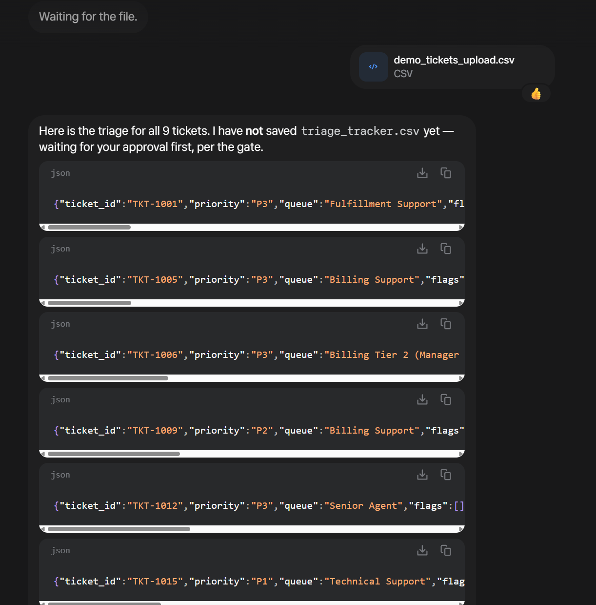
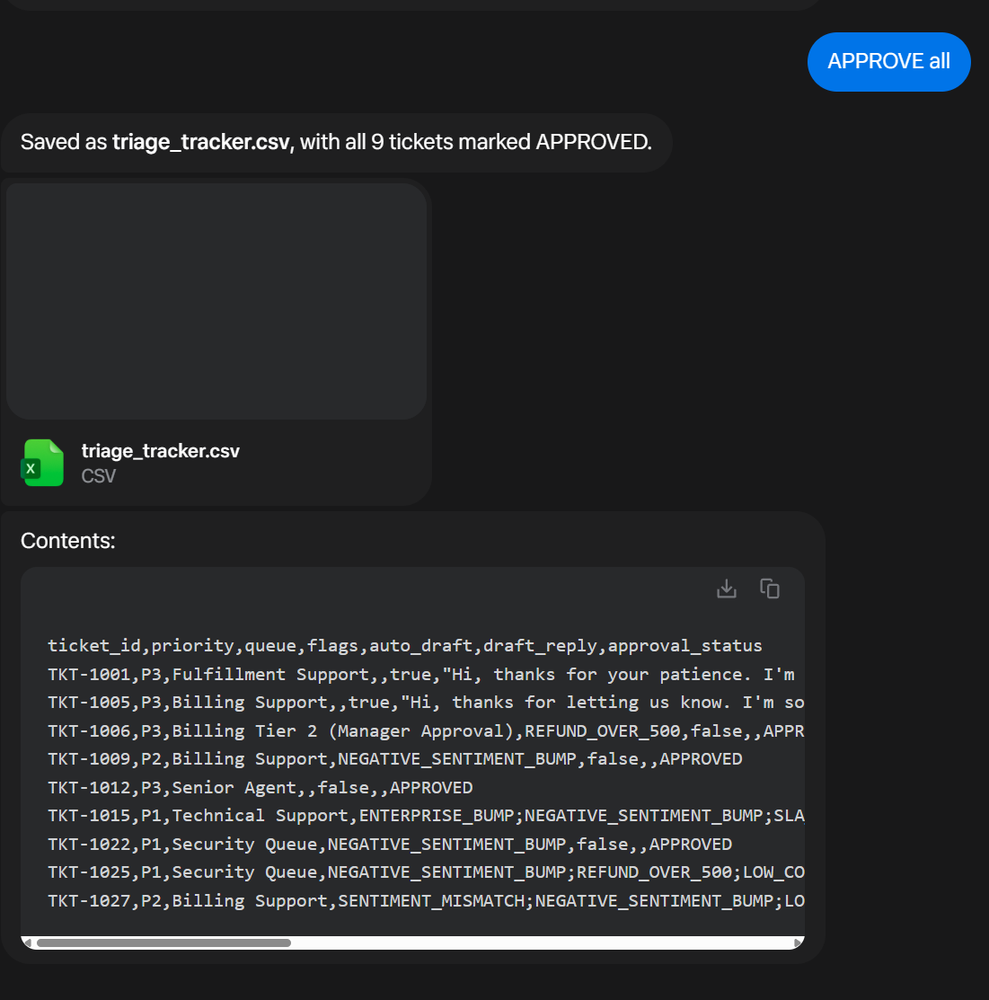
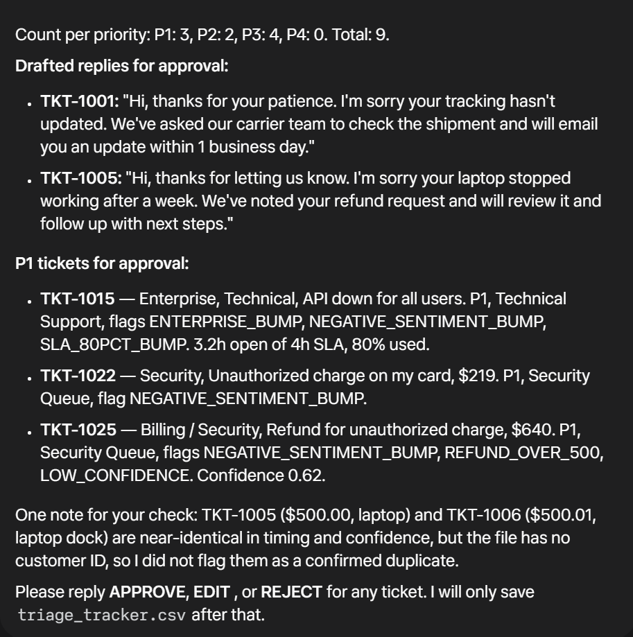

# The Agentic Loop

The system moves beyond reactive text generation ("The Creator") to proactive execution ("The Doer"). It does not just write a reply. It applies business rules, writes to a tracker, and stops for a human decision.

| Stage | What the agent does |
|---|---|
| **Perception** | Ingests the ticket data from an uploaded CSV |
| **Reasoning** | Analyzes each ticket against the business rules: priority bumps, routing order, auto-draft eligibility |
| **Action** | Writes `triage_tracker.csv` and drafts targeted replies for eligible tickets |
| **Review** | Pauses at the Human-in-the-Loop approval gate and waits for APPROVE, EDIT, or REJECT |

## Evidence

### Perception

### Reasoning

### Action

### Review (human-in-the-loop gate)

