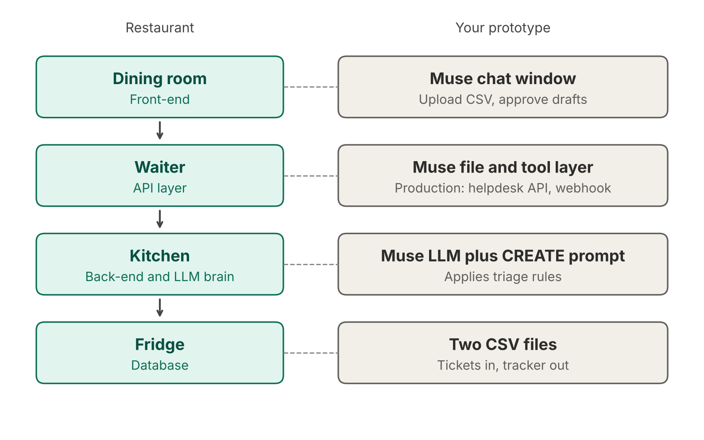

# System architecture: the Restaurant Analogy

| Restaurant | Prototype | Production equivalent |
|---|---|---|
| **Dining room** (front-end): what the user sees and interacts with | Muse chat window, where the support lead uploads tickets and approves drafts | Helpdesk agent dashboard |
| **Waiter** (API layer): how requests and responses travel | Muse file and tool layer | Helpdesk API or webhook triggered by each new ticket, plus an MCP connector to the CRM |
| **Kitchen** (back-end and LLM brain): where reasoning and prompt execution occur | LLM plus the CREATE system prompt | Hosted model with routing between cheap and frontier models |
| **Fridge** (database): where data is stored | Two CSV files: tickets go in, triage tracker comes out | Ticket database |
| **Head chef tasting the dish** | Human-in-the-loop approval gate | Agent or manager reviews queue |

Nothing leaves the kitchen until the head chef approves it. That is the human-in-the-loop gate, explained further in [governance.md](governance.md).
